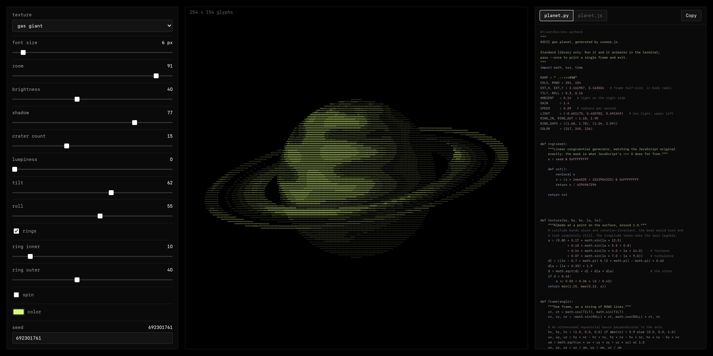

# cosmos.js

An ASCII planet generator. Tune a planet with sliders, then copy out standalone
Python or JavaScript that draws it and drop that into any project you like.

Nothing is pre-rendered. Every glyph is a ray cast at a body, shaded from a real
lighting model and quantized onto a density ramp.

**Try it: [msaunders.dev/cosmos](https://msaunders.dev/cosmos/)**



## Run it locally

Python 3, standard library only. Nothing to install.

```sh
git clone https://github.com/mattsaund/cosmos.js.git
cd cosmos.js
python3 cosmos.py
```

It serves `web/` on a free loopback port, opens your browser at it, and shuts
itself down when you close the tab.

```sh
python3 cosmos.py --no-open    # just print the URL
python3 cosmos.py --port 8000  # a fixed port instead of a free one
python3 cosmos.py --verbose    # log every request
```

You can also skip Python entirely and open `web/index.html` in a browser. It is
the same app, with no build step and no dependencies.

## The controls

Sliders run 0 to 100 and map onto whatever range the setting needs, except two
that show their real value:

- **font size** is the glyph height in px. The grid always fills the preview,
  so this is also the resolution: a smaller glyph means more of them.
- **crater count** is how many impacts are scattered on the surface.

**zoom** at 100 is the planet as large as the preview holds. It stops there, so
the planet never runs off the edge.

## Taking a planet with you

Three ways out:

- **Copy planet to clipboard** puts the frame on screen into your clipboard as
  plain text, ready to paste into anything.
- **Save screenshot** writes the same frame to a 3840x2160 PNG on black,
  trimmed and scaled so the planet fills the picture.
- The **planet.py** and **planet.js** panes hold a standalone program that
  draws the planet you designed. Copy either one and run it anywhere.

## Contributing

Issues and pull requests are welcome.

**AI policy.** I am open to AI and agentic coding, but the code that comes out
of it has to hold up:

1. It must be human readable, with sensible variable and function names.
2. It must be easy to trace, following a clear program flow.
3. You must read and document what you submit. You need to understand the code
   you are contributing.

## License

[MIT](LICENSE), Copyright (c) 2026 Matthew Saunders.

The Python and JavaScript this tool generates for you is yours. Use it in
anything, commercial or not, with no attribution required. Each exported file
carries a `generated by cosmos.js` comment, which you are free to delete.

Two things in here are not mine:

- **Paper Mono**, the typeface in `web/fonts/`, from
  [paper-design/paper-mono](https://github.com/paper-design/paper-mono). It is
  licensed under the SIL Open Font License 1.1, and its copyright notice and
  license travel with it in [web/fonts/OFL.txt](web/fonts/OFL.txt).
- The character ramp is Paul Bourke's ten level grayscale ramp.

Built by Matthew Saunders, [msaunders.dev](https://msaunders.dev)
